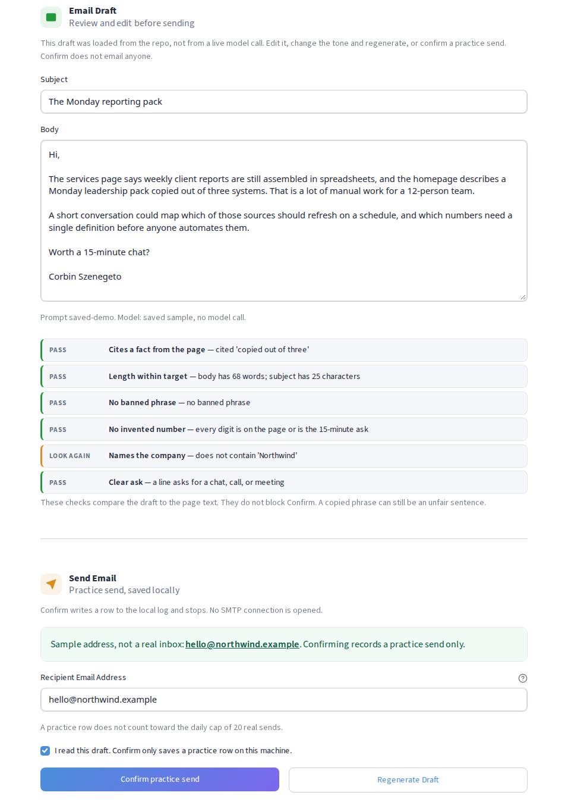
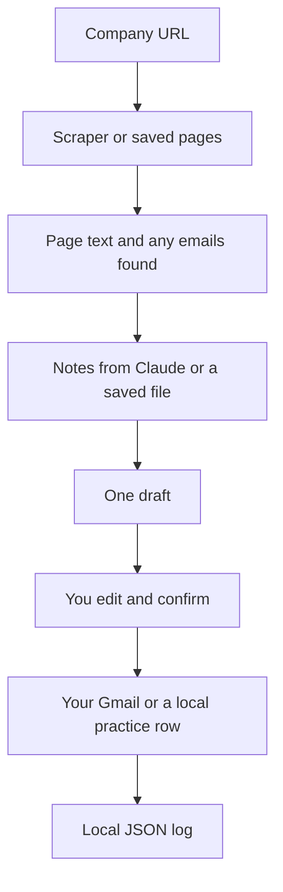

# AI Outreach

**Personal project by Corbin Szenegeto.** I built this in my spare time. It is not a commercial product.

Paste a company website. The app reads a few public pages, drafts one email you can edit, and sends it only after you confirm.

[](https://github.com/corbinsz/ai-outreach-automation/actions/workflows/ci.yml)



```bash
make setup && make demo
```

Streamlit prints `http://127.0.0.1:8501` on your machine. Click **Run this sample** for Northwind Analytics. Confirm writes a practice row. It does not send email.

`make eval` scores the saved drafts with no API key. The rubric and the measured results are in [docs/PRODUCT.md](docs/PRODUCT.md).

## Setup

Python 3.10 or newer. `make setup` creates `.venv`, installs dependencies, and copies `.env.example` to `.env` if you do not already have one. The values in the example file are placeholders, not keys. If a live run is missing a key, the app says so and tells you to use demo mode.

```bash
git clone https://github.com/corbinsz/ai-outreach-automation.git
cd ai-outreach-automation
make setup
make demo
```

Without make:

```bash
python3 -m venv .venv
source .venv/bin/activate  # Windows: .venv\Scripts\activate
pip install -r requirements-dev.txt
cp .env.example .env
DEMO_MODE=1 streamlit run app.py --server.address 127.0.0.1
```

Live mode is `make run` after you replace `your-anthropic-api-key` in `.env`. Gmail is only needed when you send. Use an app password from your Google account security settings, not your login password: [Google Account Security](https://myaccount.google.com/security).

## Features

- One URL, or a list. The list drafts only. It does not send.
- Notes split a quote copied from the page from a labeled guess. Four tones. You can edit the draft or regenerate it.
- A checklist compares the draft to the page before you send. It warns. It does not send, and it does not block you.
- Send only after you tick that you read the draft and press Confirm, from your own Gmail, to one address you chose. Live mode does not fill the To field in. A local cap of 20 real sends per day can refuse the send.
- A local log where you can mark a note opened or replied, and set a follow-up date. Those marks are manual. There is no tracking pixel. Edits use the row id.
- Demo mode: two fictional companies saved in the repo, so the whole path runs with no API key and no network. Prompt version `2026.11.1` is recorded on live drafts. See [docs/PROMPT.md](docs/PROMPT.md).

## How it's built



Python modules under `src/` do the work. Streamlit is the review screen. Pydantic checks the records passed between steps. Claude writes the live notes and the live draft. The prompt version is in `src/prompts.py`. Gmail SMTP sends, and only when you confirm. The scraper names itself, skips paths `robots.txt` disallows, and refuses private addresses. Playwright is optional, for pages that are mostly JavaScript, and it uses the same name.

The product write-up is [docs/PRODUCT.md](docs/PRODUCT.md). The engineering notes are [docs/PRODUCT_NOTES.md](docs/PRODUCT_NOTES.md). Short decision records are in [docs/adr](docs/adr/0001-confirm-before-send.md).

```
ai-outreach-automation/
├── app.py                 # Streamlit review screen
├── src/                   # Scrape, analyze, draft, send, demo mode
├── fixtures/demo/         # Two sample companies and their saved drafts
├── fixtures/eval/         # Twelve fictional pages for the offline rubric
├── tests/                 # pytest, no network
├── docs/                  # Product notes and decision records
├── Dockerfile             # Optional local run, demo mode by default
└── .github/workflows/ci.yml
```

## Tests

```bash
make check
```

That is Ruff, Black, mypy, and pytest with a coverage report for `src` (the floor is 90%). The suite mocks Claude and SMTP. It does not call the network and does not need keys. Demo-mode tests fail if a sample run touches the network. `make eval` is the offline score for saved notes and drafts. GitHub Actions runs `make check` and `make eval`.

## Limits

A fuller account is in [docs/PRODUCT.md](docs/PRODUCT.md) and [docs/PRODUCT_NOTES.md](docs/PRODUCT_NOTES.md).

- Scraping still breaks on odd layouts and on sites that block unknown clients. The User-Agent is `AIOutreach/1.0`, and `robots.txt` is checked. A public hostname that points at a private address is not detected. See [docs/adr/0004-honest-scrape.md](docs/adr/0004-honest-scrape.md).
- The model will sometimes invent a pain point. Quotes and guesses are separate fields, and a thin page shows a warning. `make eval` scores saved text. The review screen runs the same string checks on the draft you are editing. A copied phrase can still be an unfair sentence, and a failing check does not block Confirm.
- Cold email from a personal Gmail account lands in spam. Google's help page describes a block after more than 500 messages in a day, or one message to more than 500 people: [Limits for sending and getting mail](https://support.google.com/mail/answer/22839). This app stops at 20 real sends logged today on this machine. That is not Gmail's count. See [docs/adr/0005-daily-send-cap.md](docs/adr/0005-daily-send-cap.md).
- The app does not check that the recipient wants to hear from you. You have to identify yourself, have a reason to write, and stop when someone asks.
- There are no users and no usage numbers. It is a spare-time project.

## Deploying it yourself

Nothing in this repo is deployed. There is no public URL. The steps below are for a machine you control. Do not commit secrets. Prefer demo mode unless you mean to send real mail.

`make demo` and `make run` listen on loopback. The config file leaves the bind address to the command that starts the app, so a host can reach the process. Docker listens on all of the container's interfaces, and Compose publishes that port on loopback.

### Docker

```bash
docker compose up --build
```

Compose publishes the app on `http://127.0.0.1:8501` and turns demo mode on. The process inside the container listens on all of its own interfaces so the published port works. The published port is bound to loopback.

To send real mail from a container, set `DEMO_MODE` to `0` and pass `ANTHROPIC_API_KEY`, `GMAIL_ADDRESS`, and `GMAIL_APP_PASSWORD` in the environment. Do not bake them into the image. The image does not install a Playwright browser. The JavaScript fallback needs that browser only for live scrapes of thin pages.

### Streamlit Community Cloud

1. Push the repo to GitHub. Private is fine.
2. Create an app from this repo with main file `app.py`.
3. Add `ANTHROPIC_API_KEY` in the host's secret settings. Add the Gmail values only if you intend to send.
4. Leave `DEMO_MODE` unset, or set it to `0`, when you want live pages.

The host will assign an address. This repo does not include one, and this project is not deployed there.

### Render

1. Create a web service from this repo and choose Docker.
2. The image listens on port 8501. Set the service port to 8501.
3. Add the same environment variables in the host's dashboard. Keep demo mode on if you only want the sample companies.

Do not put a live address for this app back into the README.

## License

[MIT](LICENSE). Copyright 2026 Corbin Szenegeto.
