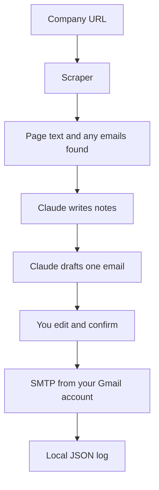
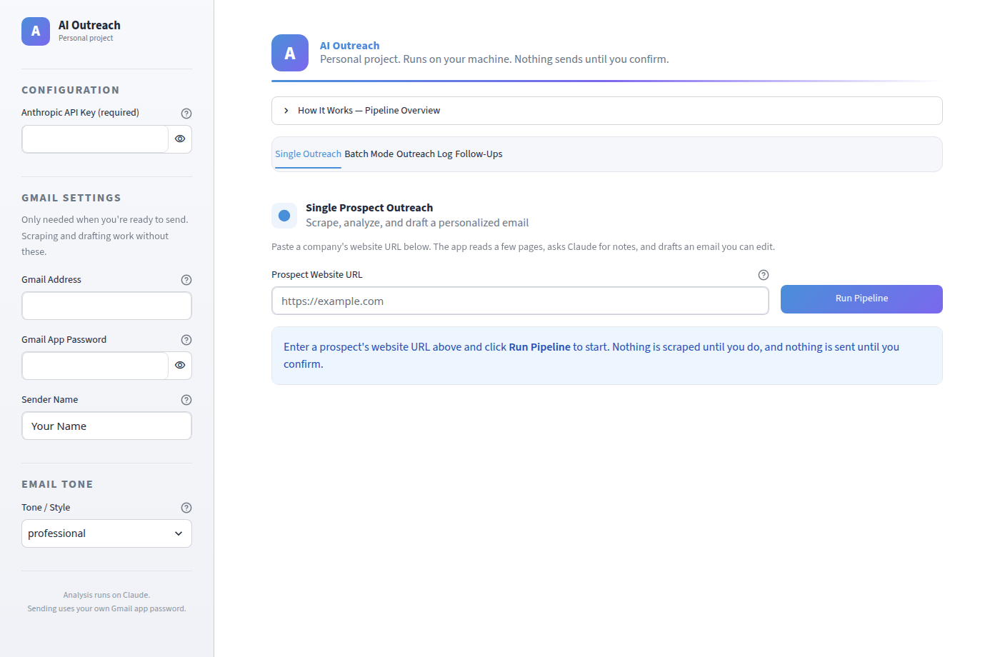

# AI Outreach

**Personal project by Corbin Szenegeto.** I built this in spare time, for fun and to learn the workflow. It is not a commercial product. There is no hosted copy, no signup, and no public URL. You run it on your own machine.

Paste a company website. The app reads a few public pages, asks Claude for structured notes, and drafts a cold email in a tone you pick. You edit the draft. Mail goes out only after you confirm, and it goes out from your own Gmail account.

I made it while practicing the questions behind product, project, RevOps, and data work: who the user is, what the steps are, which shortcuts are acceptable, and how you would know the output is bad.

The longer write-up of decisions, limits, and what I would build next is in [docs/PRODUCT_NOTES.md](docs/PRODUCT_NOTES.md).

## Who it is for

One person working a short list of prospects, reviewing every draft. That person is me. It is not a tool for a sales team, and it does not send on a schedule.

## Workflow



Scraping and drafting need an Anthropic API key. Sending needs your Gmail address and a Gmail app password, which is not your normal login password. The app has no other way to send mail.

## Run it locally

Requires Python 3.10 or newer. Continuous integration runs on Python 3.12.

```bash
git clone https://github.com/corbinsz/ai-outreach-automation.git
cd ai-outreach-automation
python -m venv venv
source venv/bin/activate  # Windows: venv\Scripts\activate
pip install -r requirements.txt
cp .env.example .env
```

Put your own values in `.env`. The placeholders in `.env.example` are not credentials. You can skip the file and type the same values in the sidebar. `SENDER_NAME` is optional. If it is missing, drafts use `Your Name` until you change it.

```
ANTHROPIC_API_KEY=your-anthropic-api-key
GMAIL_ADDRESS=you@gmail.com
GMAIL_APP_PASSWORD=your-16-character-app-password
SENDER_NAME=Your Name
```

Gmail settings are only required when you send. Analysis and drafting work with the Anthropic key alone.

Google will not accept a normal Gmail password for this SMTP login. Create an app password:

1. Open [Google Account Security](https://myaccount.google.com/security).
2. Turn on 2-Step Verification if it is off.
3. In account settings, open App passwords and create one for Mail.
4. Put that 16-character password in `GMAIL_APP_PASSWORD`.

Playwright is optional. Install it only if you want the JavaScript fallback:

```bash
playwright install chromium
```

Start the app:

```bash
streamlit run app.py
```

Streamlit prints `http://127.0.0.1:8501`. The server is bound to loopback, so that address is only on your machine. The deploy button in the Streamlit toolbar is hidden because this project is not meant to be published.

This is that screen before a URL is run. No site has been scraped and Claude has not been called. The text in the URL box is the placeholder.



### Tests and lint

```bash
pip install -r requirements-dev.txt
ruff check .
black --check .
pytest
```

The suite mocks Claude and SMTP. It does not call the network and does not need keys. GitHub Actions runs the same three commands on pull requests.

## What the screen can do

- Run one URL, or a list. The list drafts only. It does not send.
- Pick a tone, then edit or regenerate the draft.
- Send only after you press confirm, from your own Gmail account.
- Mark a logged email opened or replied, and set a follow-up date. Those marks are manual. There is no tracking pixel.

## Limits, in short

A fuller account is in [docs/PRODUCT_NOTES.md](docs/PRODUCT_NOTES.md). The parts that matter before you use it:

- Scraping breaks on JavaScript-heavy sites, odd layouts, and sites that block bots. The scraper does not read `robots.txt`, and its User-Agent pretends to be Chrome.
- Claude will sometimes invent a pain point, especially when the page is thin. The screen shows that text as analysis. Nothing in the app scores whether the draft is any good.
- Cold email from a personal Gmail account lands in spam, and Google caps how much a personal account can send. Their help page describes a block after more than 500 messages in a day, or one message to more than 500 people: [Limits for sending and getting mail](https://support.google.com/mail/answer/22839). The cap can change, and spam complaints can stop an account sooner.
- The app does not check that the recipient wants to hear from you. Scraping a site and emailing an address you found there can violate a site's terms or the law where you or they live. You have to identify yourself, have a reason to write, and stop when someone asks.

## Layout

```
ai-outreach-automation/
├── app.py                  # Streamlit review screen
├── assets/styles.css       # Local stylesheet, no remote fonts
├── src/                    # Scrape, analyze, draft, send
├── tests/                  # pytest, no network
├── docs/PRODUCT_NOTES.md   # Decisions, limits, roadmap
├── .github/workflows/ci.yml
├── requirements.txt        # Pinned runtime packages
└── requirements-dev.txt    # pytest, ruff, black
```

`logs/` is created at runtime and is gitignored.
