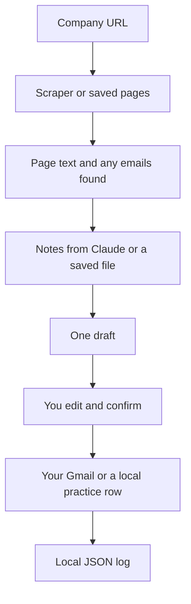

# Product

Personal spare-time project by Corbin Szenegeto. This is not a company, not a launched product, and not something a team uses. There are no customers and no usage numbers. The notes below are the product thinking behind the build, not a report of results.

The longer engineering account is [PRODUCT_NOTES.md](PRODUCT_NOTES.md). The decisions that should stay put are in [adr/](adr/0001-confirm-before-send.md).

## Problem

Writing a cold email that mentions something real about a company takes a pass over their site and then a careful draft. The boring failure is a template that could have gone to anyone. The dangerous failure is a tool that sends that template on its own.

The job is small: turn one URL into notes and one draft a person can edit, then send from that person's own inbox only if they still want to.

## Target user

One person, working a short list, willing to read every draft before it leaves. That person is me. I built this to practice the questions behind product, analytics, and operations work: who the user is, which step is worth automating, and how you would know the output is bad.

A sales team, a shared inbox, and a sequence tool are a different product. They are out of scope on purpose.

Someone reading the repo can also run it. Demo mode exists for that person. It is not a second customer segment, and I am not counting repo views as usage.

## User stories

1. As the person running the list, I paste one company URL and get notes that point at something on the site, plus one draft I can edit.
2. As that person, I pick a tone, regenerate, and change the subject and body before anything is sent.
3. As that person, I confirm a single recipient. The message goes out from my own Gmail account, or it does not go out.
4. As that person, I can run several URLs and stop at the drafts. A list cannot mail itself.
5. As that person, I can mark a send as opened or replied, and set a follow-up date. Those marks are things I know, not pixels.
6. As someone reviewing the repo, I can run the whole path with `make demo`, with no API key and no network, and see that confirm does not send mail.

## Success metrics

I have not measured these. There is no campaign, no baseline, and no dashboard of results. If I used this on a real list, the numbers I would keep are:

- Of the drafts I actually send, how many I send without rewriting the first paragraph. That is a rough check that the draft was specific.
- Replies per 20 emails I chose to send. I would not count demo rows, and I would not count mail that bounced.
- Minutes from pasting a URL to a draft I am willing to send.
- How often I stop at the confirm step. A high stop rate can mean the safeguard is doing its job.

I am not publishing a score. I have not collected one.

## What was scoped out, and why

- **Scheduled or unsupervised sending.** The failure mode of this product is mail the person did not read. Batch mode drafts and stops.
- **A team inbox, seats, or a shared login.** One operator is the whole design. Gmail app passwords are a bad fit past that, which is [ADR 0002](adr/0002-gmail-smtp-app-password.md).
- **Open tracking.** A pixel needs a public endpoint this app does not have, and it records someone opening mail they did not ask for.
- **Purchased lists and blast sends.** The confirm step is one address. A comma-separated list is rejected.
- **A CRM, a database server, or a hosted log.** A JSON file on the laptop is enough to see what was sent. It is a bad multi-user store.
- **An agent framework.** Four functions with typed records between them are easier to test than a framework that hides the handoff. See the engineering notes.
- **Scoring draft quality automatically.** The tests check that saved demo drafts stay specific and short. They do not know whether a live draft is true or fair. I read the draft.

## Risks

Cold email can be illegal, against a site's terms, or simply unwanted. The app does not know the rules where you or the recipient live, does not add an unsubscribe link, and does not check that you have a relationship with the person. Scraping a site and writing to an address published there can violate the site's terms.

Claude will sometimes invent a pain point, especially when the page is thin. The screen labels the result as notes. A thin page gets a warning. Nothing in the app scores whether the draft is true.

Mail from a personal Gmail account is easy for spam filters to drop. Google's own help page describes a block after more than 500 messages in a day, or one message to more than 500 people ([Limits for sending and getting mail](https://support.google.com/mail/answer/22839)). That number is Google's, it can change, and looking like a blast can limit an account sooner. This app enforces no daily cap.

The log stores the subject and body of every attempt, including failures, in a local file that is not encrypted.

## Human in the loop

This is the safeguard, and it is also [ADR 0001](adr/0001-confirm-before-send.md).

- The pipeline stops at a draft.
- The screen sends only after Confirm, and only to the one address in the To field.
- Live mode does not fill that field in. The person chooses.
- Batch mode cannot send.
- There is no scheduler.
- Demo mode's confirm writes a local row and does not open a mail connection. See [ADR 0003](adr/0003-offline-demo-mode.md).

Confirm is not a compliance check. If I use the tool, the bar is a specific reason to write, my real name in the sign-off, a way for the person to say no, and no sending to a list I have not read.

## How it is built, in one pass

Python, Streamlit, BeautifulSoup, Pydantic, the Anthropic API, and Gmail SMTP. Playwright is an optional fallback when a page is mostly JavaScript. Demo mode uses none of the network.

## Roadmap

In the order I would actually do them. Items already done are marked so this list does not pretend they are still open.

1. **Done for the saved drafts, open for live ones.** The demo tests check length, a banned opener, and a phrase from the saved page. A live prompt change is still unmeasured.
2. **Partly done.** Live mode does not prefill the recipient, and a thin page shows a warning. There is still no split between a quote and a guess.
3. **Open.** An identifiable User-Agent and a `robots.txt` check. The scraper still pretends to be Chrome.
4. **Open.** A small daily send cap, well under Gmail's published limit, counted from the log. OAuth only if someone other than me sends.
5. **Partly done.** New rows have an id, and the follow-up button uses it. SQLite is still unnecessary while this is one person and one file.

I am not planning a public deployment, unsupervised sending, or a tracking pixel.
