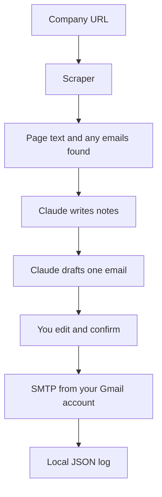

# Product notes

Personal project by Corbin Szenegeto. Built in spare time to learn the workflow, not to ship a product. There is no hosted version and no usage data. Nothing below is a customer result.

The product write-up is [PRODUCT.md](PRODUCT.md). Decisions that should stay put are in [adr/](adr/0001-confirm-before-send.md). These notes are the longer engineering account.

## Problem and user

Writing a cold email that mentions something real about a company takes a pass over their site and then a careful draft. The boring failure mode is a template that could have gone to anyone.

The user is one person, me, working a short list and willing to read every draft before it sends. The job to be done is: turn a URL into notes and a draft I can edit, then send from my own inbox if I still want to. A team inbox, a sequence tool, and a shared login are out of scope.

## Workflow

1. The scraper fetches the homepage and follows internal links whose path or text looks like About, Services, Blog, Contact, and a few similar words. It keeps at most 8 pages and waits 1 second between requests after the homepage.
2. Claude receives the text and returns JSON: summary, industry, services, pain points, opportunities, a short value note, and one angle.
3. A second Claude call writes one email in a chosen tone. The sign-off is `SENDER_NAME`, or whatever is typed in the sidebar.
4. The screen shows the draft. Nothing is mailed until Confirm is pressed. Batch mode never reaches send.
5. A successful, failed, or demo send is appended to `logs/outreach_log.json`. Opened, replied, and follow-up dates are fields you set by hand. A follow-up edit uses the row id written with that send.

The screen calls `OutreachAgent.run_pipeline` (and `run_batch` for a list) and moves the progress bar from the callback. Demo mode is the same path with saved pages and saved drafts, so a reviewer can reach the confirm step without a key.

## Design decisions and tradeoffs

**A plain pipeline instead of an agent framework.** Four functions with Pydantic models between them are easier to test and to debug than a framework that hides the handoff. The cost is that I wire the steps myself, including the duplicated path in the UI.

**Pydantic at the boundary.** A model reply that is missing a field fails before SMTP. The cost is that a slightly different but still useful JSON shape is a hard error.

**JSON recovery for fenced replies.** The prompt asks for raw JSON. Models still wrap it. `parse_llm_json` strips a fence or slices out the first object. The cost is that a reply with two objects, or an object plus commentary that itself contains braces, can parse the wrong span.

**SMTP with an app password, not Gmail OAuth.** One person can set this up in a few minutes without a Google Cloud project. The cost is real: app passwords can be disabled by Google, there is no per-user consent screen, and this is a poor fit if more than one person ever sends. I would not keep this choice for a shared tool.

**A JSON file instead of a database.** I can open the log and see exactly what was sent. New rows have an id, and the follow-up button on the send screen uses that id. The cost is still no locking: two processes can overwrite the file, and a row written before ids existed has an id only after the next edit.

**Manual open and reply tracking.** A tracking pixel needs a public endpoint this app does not have, and it records someone opening mail they did not ask for. The log fields exist so I can mark what I actually know. The cost is that "opened" means I said it opened. The counts on the log screen are counts of my own marks, not engagement.

**Requests first, Playwright second.** Most of the time a GET is enough, and the tests can run without a browser. Playwright is a fallback when the extracted text is under 100 characters. The cost is a second, heavier code path that still fails on login walls and aggressive bot checks.

**A pinned model id.** `claude-sonnet-4-5-20250929` is a constant in `src/models.py`. A silent SDK default would change the drafts without a diff. The cost is that the id will go stale when Anthropic retires that snapshot, and the app will fail until it is updated. There is no fallback model.

**Character truncation, not a token budget.** Analysis keeps 15,000 characters of scraped text and each page keeps 5,000. That bounds cost and keeps one site from flooding the prompt. The cut is by character, so it can split a word, and it drops the rest of the site with no signal other than a truncation note.

## What it does well

- It separates research, drafting, and sending. You can stop after a draft, and batch mode cannot send.
- Demo mode runs that same path on two saved companies. It does not call Claude, fetch a site, or open SMTP.
- The sender name is configuration, not a brand baked into the prompt.
- Transient Claude and SMTP errors are retried. A bad Gmail password and a rejected recipient are not, because a retry will not fix them.
- Scraped addresses drop a few obvious non-contacts (`noreply`, `example.com`, image filenames).
- The pytest suite exercises parsing, retries, the log, and the pipeline with mocks. It runs without API keys. GitHub Actions runs lint and that suite.

## What it does not do well

**Scraping is fragile.** Keyword matching on the URL and the link text will miss pages that use other words and will grab pages that merely contain "about" or "blog". Sites that render in the browser return a thin document until Playwright runs, and Playwright is optional. The scraper does not read `robots.txt`. The User-Agent string imitates Chrome so simple filters still return HTML. That gets more text back and it misrepresents the client.

**Model output varies, and some of it is invented.** The analysis prompt says to stay grounded, and it also says to make reasonable inferences when the page is thin. The UI labels the result "Prospect Analysis" with no confidence and no split between quoted page text and a guess. I have no scored set of drafts. A prompt change can make emails worse and the tests will still pass, because the tests check that JSON parsed, not that the email is specific or true.

**Deliverability and spam.** This is cold email from a personal Gmail account over SMTP. Gmail's own spam filters, and the recipient's, will treat unexpected mail as spam. I do not control a separate sending domain, warmup, or bounce handling. Google's help page says a personal account can be blocked after more than 500 messages in a day, or a single message to more than 500 people ([Limits for sending and getting mail](https://support.google.com/mail/answer/22839)). That number is Google's, it can change, and looking like a blast can get an account limited sooner. The app itself enforces no daily cap.

**The first scraped address is not a person you chose.** Live mode lists addresses it found and leaves the To field blank. Demo mode fills in the sample `.example` address so the practice send can be clicked. The app still will not stop you from typing an address you should not use.

**Gmail app passwords and SMTP limits.** Sending depends on an app password. Google can refuse that login method. SMTP retries are immediate, with no backoff, up to three tries. The log stores the subject and body of every attempt, including failures, in a local file that is not encrypted.

**Follow-ups are a reminder list.** There is no mail-server clock. "Save Follow-Up" after a send writes the row with that send's id. Snooze and "mark replied" are local edits. The log screen still edits by position, which is the order on screen, so inserting a row above an open expander would point an older button at a different record until the next refresh.

**English only.** The prompts and the scraper assume English pages and an English email.

**The log is not a CRM.** There is no dedupe, no thread view, and no import. Two processes writing the file can corrupt it. I have not load-tested it because it is a list I would keep short on purpose.

## Ethics and consent

This tool can scrape a site and help send email to an address that was published for a different reason. The app does not ask whether you have a relationship with the recipient, does not add an unsubscribe link, and does not know the rules where you or they live. Cold email can be illegal, against a site's terms, or simply unwanted.

If I use it, the bar is: a specific reason to write, my real name in the sign-off, a way for the person to say no, and no sending to a list I have not read. The Confirm button is the control that exists today. It is not a compliance check. I would not point this at a purchased list, and I would not add open tracking.

## How quality is checked

| Check | What it actually tells me |
| --- | --- |
| pytest, with Claude and SMTP mocked | Parsing, retries, log updates, and the pipeline's stop-at-draft behavior. It does not tell me a live draft is good. |
| `make eval` on saved drafts | String checks from [DRAFT_RUBRIC.md](DRAFT_RUBRIC.md): a copied phrase, length, banned phrases, digits, the company name, and a clear ask. The counts are in [PRODUCT.md](PRODUCT.md). They are not a live model score and not a user metric. |
| Ruff, Black, and mypy in GitHub Actions | Style, a few bug patterns, and type hints. Not product quality. |
| Reading a draft before Confirm | Whether the email is specific and fair. The script does not block send. |

There is no labeled set of live sites and no record of draft quality over time. Replies are unmeasured because there is no campaign.

## Roadmap

In the order I would actually do them.

1. **A small offline check on drafts.** `make eval` scores the saved demo drafts and 12 fictional pages with the rubric in `docs/DRAFT_RUBRIC.md`. That does not score a live Claude reply. A prompt change can still make live emails worse while those checks stay green.
2. **Show uncertainty on thin pages.** Live mode no longer prefills the recipient. A page with very little text gets a warning that the notes are inferences. There is still no confidence score and no split between a quote and a guess.
3. **Scrape more honestly.** Send an identifiable User-Agent, skip paths `robots.txt` disallows, and keep the page cap. I would rather get less text than pretend to be a browser. Same-site `www` links are followed now. The User-Agent is still a Chrome string.
4. **A send cap in the app, then OAuth if anyone else sends.** Refuse to send once a small daily count is hit, well under the Gmail limit, and surface the count from the log. The app now refuses a recipient that is blank, a list, or split across lines, and it refuses to open SMTP when Gmail settings are missing. It still has no daily cap. Replace the app password with Gmail OAuth only if this stops being a single-person script.
5. **Stable log rows.** New sends get a uuid, and the follow-up button uses it. SQLite would still be the right store if two processes ever wrote the file. A hosted database is not the point.

I am not planning a public deployment, unsupervised sending, or a tracking pixel.
